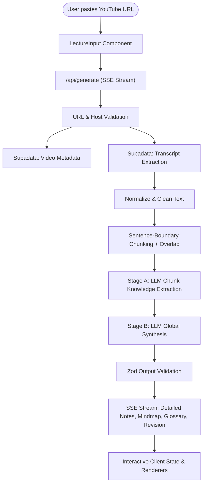

# LectureFlow (DotNote) 🎓

> **Turn YouTube lectures into comprehensive, structured study materials.**

LectureFlow is a modern, AI-powered study workspace that converts any YouTube lecture into detailed lecture notes, visual mind maps, a glossary of key definitions, and exam-oriented revision sheets.

---

## 🌟 Features

- **Detailed Lecture Notes:** In-depth, hierarchically organized class notes preserving definitions, step-by-step algorithms, derivations, worked examples, formulas, comparisons (markdown tables), and nuances.
- **Visual Mind Map:** Dynamic Mermaid mind map visualizing core topics, subtopics, and prerequisites, with an accessible nested outline fallback.
- **Keywords & Definitions:** Searchable glossary highlighting technical terminology, intuitions, and supplementary context.
- **Revision Sheet:** High-yield exam revision materials, key takeaways, formulas to remember, frequently confused concepts, and practice questions with revealable answers.
- **Clickable Timestamp References:** Source citations connected back to the exact video playback timestamp (`📍 MM:SS`).
- **Flexible Export:** 1-click Markdown copy, `.md` file download, and print-to-PDF with clean print stylesheets.
- **Real-time Progress Streaming:** Live server-sent progress updates tracking validation, transcript retrieval, chunk analysis, and synthesis.
- **Privacy First & Ephemeral:** Zero database, zero persistent chat logs, zero server-side storage of transcripts or notes. Everything lives in the user's browser session.

---

## 🛠️ Technology Stack

- **Framework:** [Next.js](https://nextjs.org/) (App Router, Turbopack)
- **Language:** TypeScript (strict mode)
- **Styling:** Tailwind CSS v4, Lucide Icons
- **Transcript Extraction:** [Supadata API](https://supadata.ai/)
- **LLM Inference:** [Groq Cloud SDK](https://console.groq.com/)
  - Primary Model: `openai/gpt-oss-120b`
  - Fallback Model: `openai/gpt-oss-20b`
- **Validation:** Zod v4 schemas for all pipeline stages and API endpoints
- **Markdown Rendering:** `react-markdown` with `remark-gfm`
- **Diagrams:** [Mermaid.js](https://mermaid.js.org/)
- **Testing:** [Vitest](https://vitest.dev/) & Testing Library

---

## 🏗️ Architecture & Data Flow



### 1. URL Validation & Metadata Extraction
Accepts standard YouTube formats (`watch?v=`, `youtu.be/`, `/shorts/`, `/embed/`), validates against an explicit YouTube host allowlist, extracts video ID, and fetches metadata and duration.

### 2. Transcript Normalization & Chunking
Normalizes whitespace and punctuation without breaking formulas or identifiers. Long transcripts are split at sentence boundaries (~12k–15k characters) with overlapping context windows.

### 3. Hierarchical LLM Processing
- **Stage A (Extraction):** Runs structured knowledge extraction over chunks, extracting concepts, algorithms, formulas, and segment IDs.
- **Stage B (Synthesis):** Reconstructs teaching order, unifies definitions, generates Mermaid mind map nodes, and synthesizes revision materials.

---

## 🚀 Local Development Setup

### 1. Prerequisites
- Node.js 20.9+ (or Node 22/25)
- npm or pnpm

### 2. Clone Repository & Install Dependencies
```bash
git clone https://github.com/vishwajeet-singh-bhati/DotNote.git
cd DotNote
npm install
```

### 3. Configure Environment Variables
Create a `.env.local` file from `.env.example`:
```bash
cp .env.example .env.local
```
Add your credentials:
```env
# Supadata: https://supadata.ai/
SUPADATA_API_KEY=your_supadata_api_key

# Groq: https://console.groq.com/
GROQ_API_KEY=your_groq_api_key

# Optional settings:
GROQ_MODEL=openai/gpt-oss-120b
GROQ_FALLBACK_MODEL=openai/gpt-oss-20b
MAX_VIDEO_DURATION_SECONDS=5400
```

### 4. Run Development Server
```bash
npm run dev
```
Open [http://localhost:3000](http://localhost:3000) in your browser.

---

## 🧪 Testing & Verification

The project includes an automated Vitest test suite with 82 unit and integration tests covering:
- YouTube URL and host validation
- Video ID and timestamp parsing
- Transcript normalization and sentence-boundary chunking
- Supadata synchronous extraction, asynchronous job polling, and error handling
- Zod schema validation for LLM outputs
- Markdown export formatting
- Mermaid mind map syntax generation and label sanitization

Run the verification suite:
```bash
# Run unit & integration tests
npm run test

# Type check
npm run typecheck

# Linting
npm run lint

# Production build
npm run build
```

---

## ☁️ Vercel Deployment

1. **Push to GitHub:** Ensure your code is pushed to your GitHub repository (`DotNote`).
2. **Import into Vercel:**
   - Go to [vercel.com/new](https://vercel.com/new).
   - Select and import the `DotNote` repository.
3. **Configure Environment Variables in Vercel Project Settings:**
   - `SUPADATA_API_KEY`: Your Supadata API key
   - `GROQ_API_KEY`: Your Groq Cloud API key
   - `GROQ_MODEL`: `openai/gpt-oss-120b` (default)
   - `GROQ_FALLBACK_MODEL`: `openai/gpt-oss-20b`
   - `MAX_VIDEO_DURATION_SECONDS`: `5400`
4. **Deploy:** Click **Deploy**. Vercel will automatically build and assign a production URL.

---

## ⚠️ Provider Usage & Limitations

- **Transcript Availability:** Requires public YouTube videos with captions (auto-generated or creator-provided captions).
- **Execution Limits:** Configured with `maxDuration = 300` seconds on the generation route for long lecture synthesis.
- **Rate Limits:** Groq and Supadata enforce tier-specific rate limits. If a 429 occurs, the system surfaces clear guidance to wait and retry.
- **Session Only:** Generated notes are stored in client React state; downloading or copying before closing the browser tab preserves notes.

---

## 📄 License

MIT
